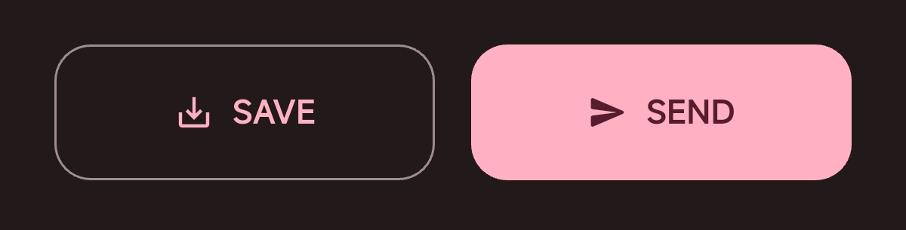
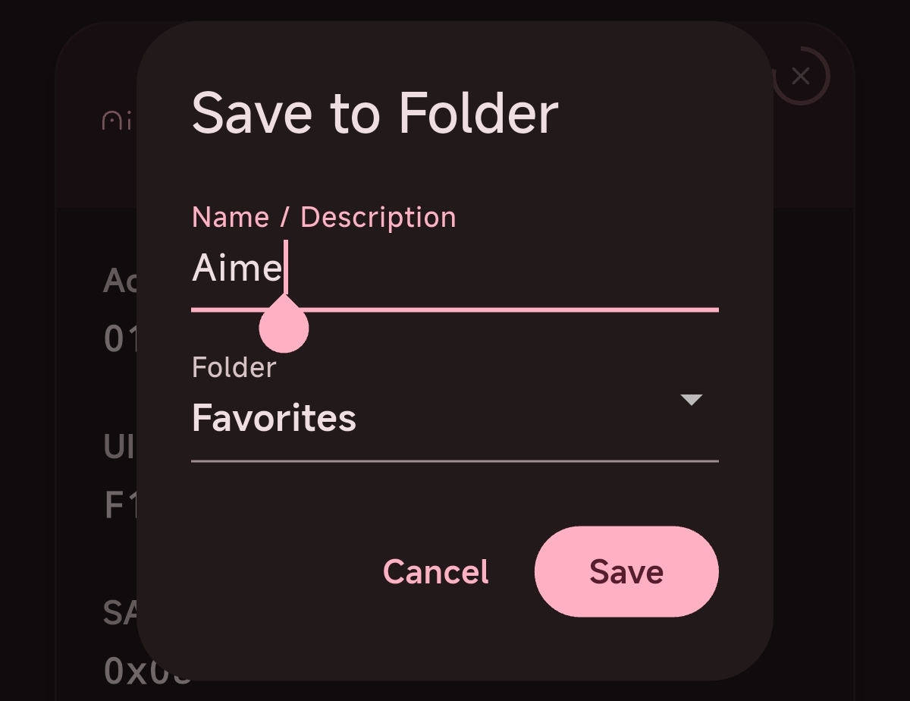
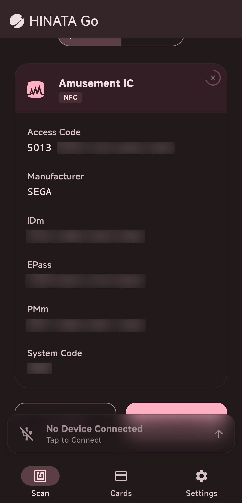
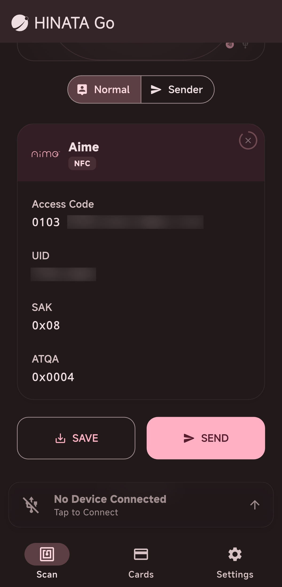
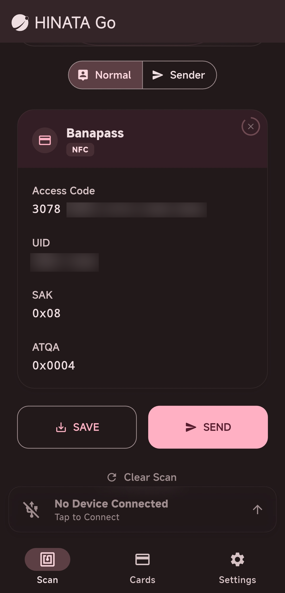

# Card Information Viewer

## Supported Card Types

### Transit Cards
* [**Japanese Transit Cards (Suica, PASMO, etc.)**](#suica-pasmo-etc)：View card balances, up to 20 recent transaction records (including transaction type, date, amount, and boarding/alighting station names resolved using the built-in database).
* [**China T-Union**](#china-t-union)：View card numbers, balances, and up to 10 recent transaction records.

### Arcade/Amusement Cards
* [**Amusement IC**](#amusement-ic)：Identify card manufacturers, display Access Codes, and view in-game legitimacy status.
* [**Legacy Aime or Compatible Cards**](#legacy-aime-or-compatible-cards)：Read Access Code and in-game legitimacy status.
* [**Legacy Banapass or Compatible Cards**](#legacy-banapass-or-compatible-cards)：Read Access Code.
* **Legacy E-Amusement Pass**：Konami in-game card number

### Other Cards
* **Any FeliCa Card**：IDm, PMm, SystemCodes, Konami in-game card number, etc. Every block that reads without encryption is also saved and can be viewed under [Raw data](#raw-data)
* **Any ISO15693 Card**：Konami in-game card number

## How to Read

Place the card on the NFC recognition area of the mobile device to read the card information, as shown:

Or connect to the HINATA Card Reader for recognition, as shown:

## Save Card

After swiping the card, slide down to see two buttons. Click the save button on the left and customize the name and folder to save.

## Read Information

### Suica / PASMO etc.

When reading Japanese transit cards, you can view:
* Balance (in JPY)
* Transaction History: includes transaction type (ride, shopping, adjustment, top-up, etc.), date, amount, and entry/exit station names (automatically resolved via the built-in Japanese station database).

### China T-Union

When reading China T-Union cards, you can view:
* Card number
* Balance (in CNY)
* Transaction History: displays recent top-ups and deductions.

### Amusement IC

### Legacy Aime or Compatible Cards

### Legacy Banapass or Compatible Cards
 

## Raw Data

After reading any FeliCa card, its details page shows a **Raw data** entry. It lists every block saved from that read, grouped by service (16 bytes each). Tap a block to copy it, or use the copy-all action in the top bar.

* Only blocks that read without encryption are read and saved; anything that needs authentication is not included.
* If the card leaves the reader mid-read, the blocks read so far are still kept, and the entry is marked **Not fully read**.
* The blocks are saved with the card, so you can inspect them offline later, and card emulation uses them.

On some readers a FeliCa card shows its basic information first and the remaining blocks come afterwards; the screen then shows "Reading extended info, please do not move the card", so keep the card in place.
