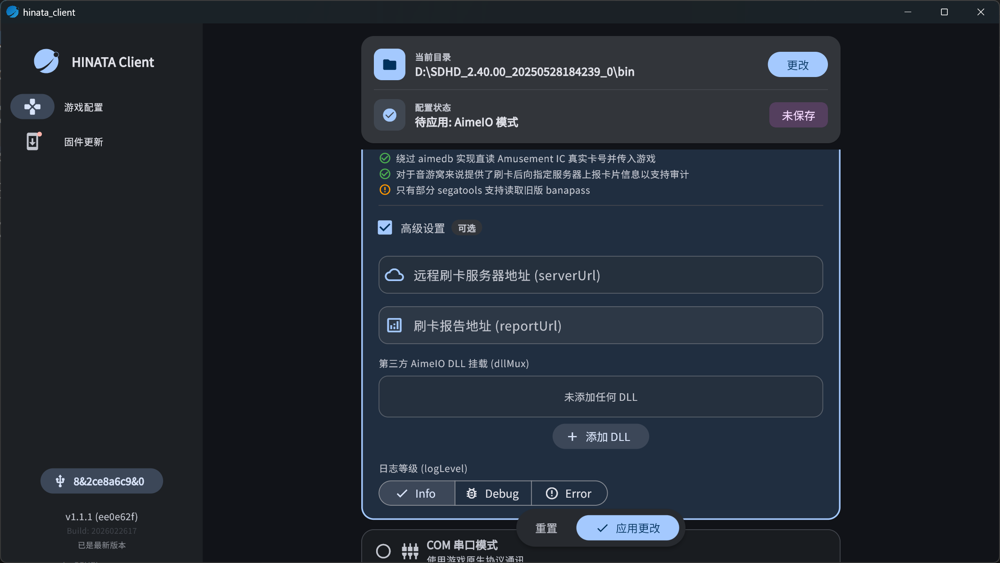
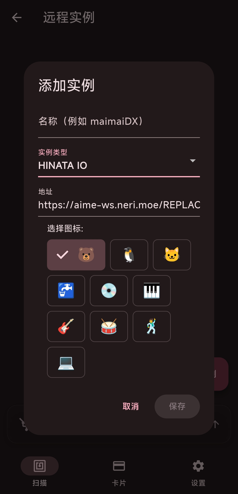
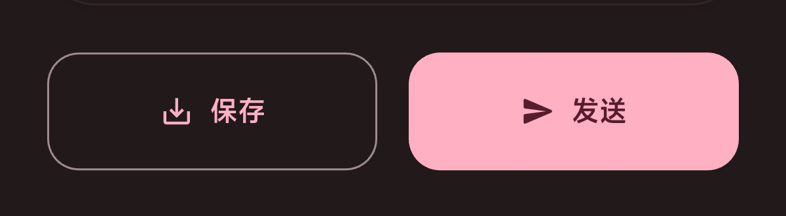
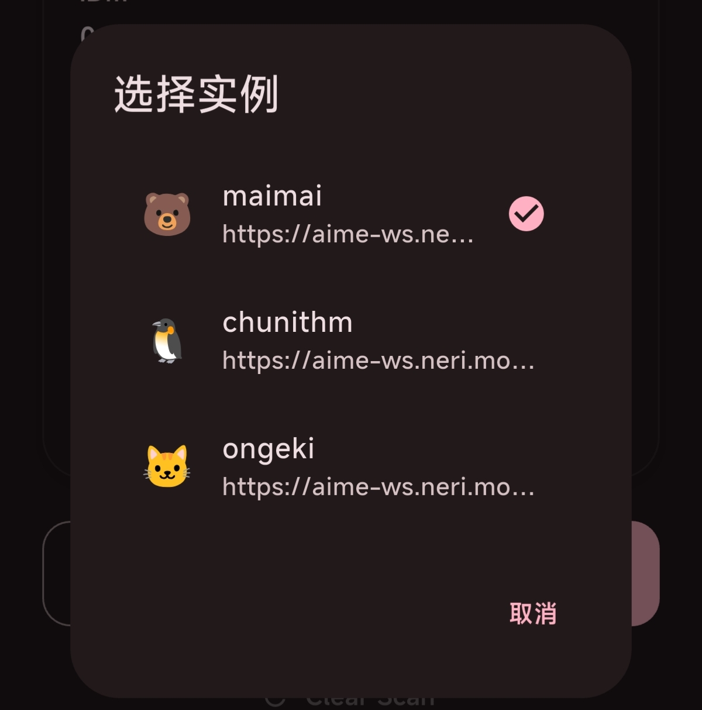
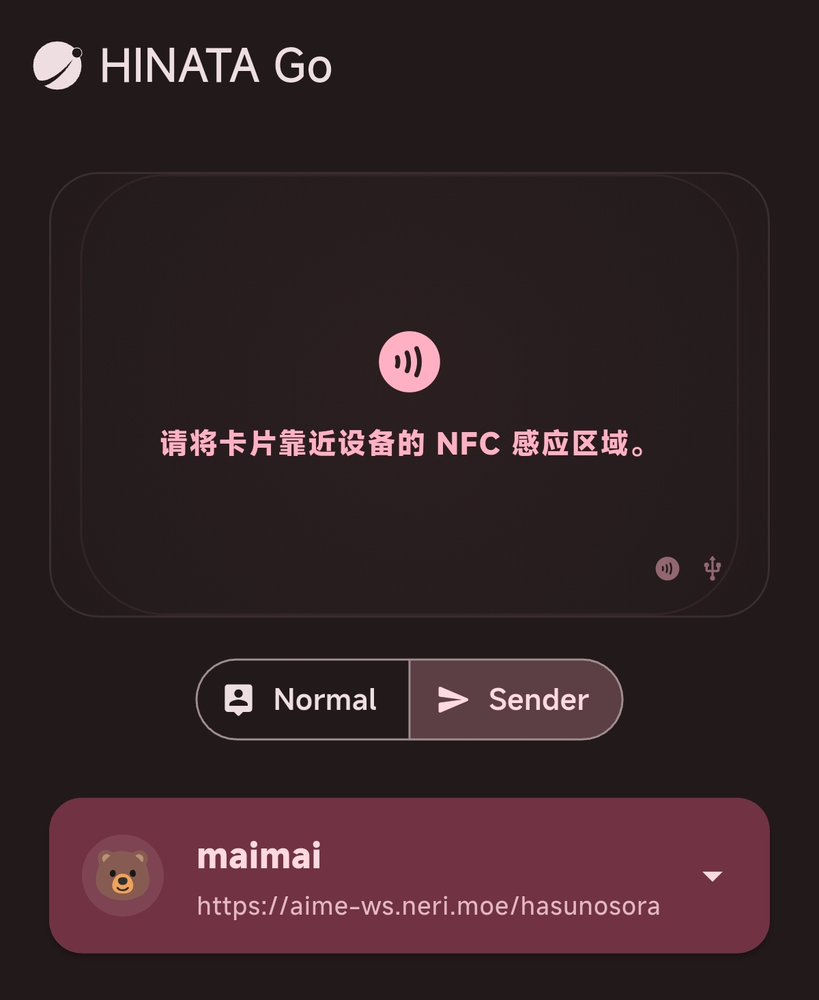

# 读卡器模式

## segatools（HINATA IO）

> **以下配置均以 HINATA 公共刷卡服务器 ( `aime-ws.neri.moe` ) 为例，请确保你的网络环境可以正常访问 Cloudflare 的服务**

1. 首先在你的游戏部署 [HINATA IO](/game-setting/sega/hinata-client/) ，然后配置远程刷卡服务器，使用文本直接编辑或使用 HINATA Client 图形化编辑均可
    ```ini
    [aime]
    enable=1

    [aimeio]
    path=hinata.dll
    serverUrl=wss://aime-ws.neri.moe/REPLACEME
    ```
    

    **将 `REPLACEME` 替换为你自定义的一串英文字符串，并确保够唯一，否则可能会和他人重复**
2. [下载最新版本的 HINATA Go](/go/index.md#下载)，安装并打开
3. 在软件内添加一个 Instance，名称自定义，URL 则配置为 `https://aime-ws.neri.moe/REPLACEME`，如图所示：

4. 打开游戏开始玩？！

## TAL（HINATA IO）

1. 参考[对应配置说明](/game-setting/bandai-namco/)将 `hinata.dll` 放入 `\Executable\Release\plugins\hinata.dll`，并在 `config.toml` 的 `[emulation]` 下开启 `card_reader = true`。
2. 在游戏主程序同级目录的 `hinata.ini` 中配置：
   ```ini
   [hinata]
   serverUrl=wss://aime-ws.neri.moe/REPLACEME
   ; 如需端到端加密，可取消下行注释并设置密码
   ; remotePassword=你的密码
   ```
3. 在 HINATA Go 内添加一个 Instance，URL 配置为 `https://aime-ws.neri.moe/REPLACEME`（若设置了 `remotePassword`，需填写相同密码）。

## spicetools（SpiceAPI）

### SpiceAPI
> **⚠️ 目前尚未搭建SpiceAPI的转发服，所以只能局域网使用，当然你也可以使用cloudflared自行转发**
1. 打开 `spicecfg.exe`
2. 找到 spiceapi 的配置项，设置port，密码留空
3. 在 HINATA Go 内添加一个Instance，URL配置为 `你电脑IP:Spice监听端口`，例如 `192.168.0.114:1145`，不需要带 `http://`

## 发送卡号到游戏

### Normal 模式

在 Normal 模式（卡片信息查看页）下刷卡后，向下滚动可以看到两个按钮。点击右侧的 **发送** 按钮，选择目标游戏实例即可将卡号发送至游戏。





### Sender 模式

切换到 HINATA Go 内的 **Sender 模式** 页面，选择活跃的游戏实例。在此模式下，通过设备内置 NFC 或外接 HINATA 读卡器刷卡，卡号将会自动实时传输到当前选中的实例中，无需任何手动操作。

